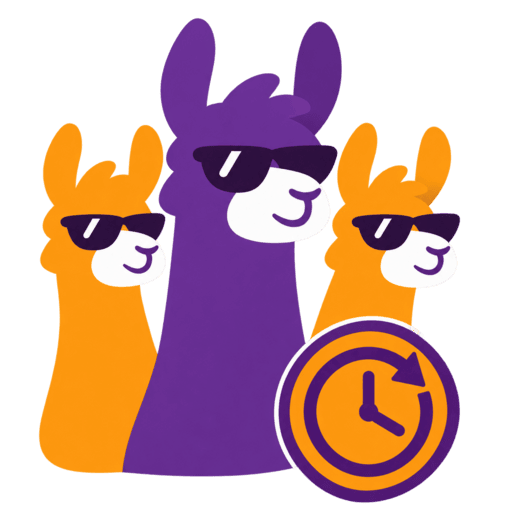

  

  
  
  
  
  
   
  
  

## About

**CrowdSec Escalation Controller** extends CrowdSec bans for repeat offenders.
It monitors local ban decisions and uses persistent per-IP history to apply
configurable exponential escalation, capped at a maximum duration.

Alerts within the same ban episode count as one offense. Existing longer bans
are preserved, and history resets after a configurable quiet period. Dry-run
mode records what would happen without creating decisions.

Run it as a standalone executable or a [container image](https://hub.docker.com/r/crazymax/cs-escalation-controller/).

> [!NOTE]
> Want to be notified of new releases? Check out 🔔 [Diun (Docker Image Update Notifier)](https://github.com/crazy-max/diun)
> project!

## Documentation

See [config.example.yaml](config.example.yaml) for configuration options and
[CONTRIBUTING.md](.github/CONTRIBUTING.md) for build and test commands.

## Contributing

Want to contribute? Awesome! The most basic way to show your support is to star
the project, or to raise issues. You can also support this project by [**becoming a sponsor on GitHub**](https://github.com/sponsors/crazy-max)
or by making a [PayPal donation](https://www.paypal.me/crazyws) to ensure this
journey continues indefinitely!

Thanks again for your support, it is much appreciated! :pray:

## License

MIT. See `LICENSE` for more details.
